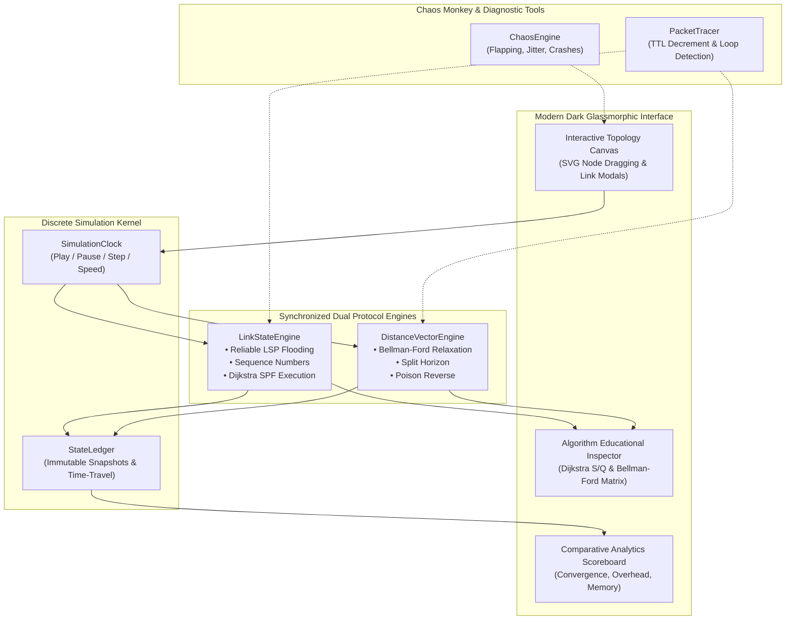

<div align="center">

# 🌐 Interactive Link State & Distance Vector Routing Simulator
### *Real-Time Comparative Networking Laboratory & Protocol Verification Engine*

[](https://www.typescriptlang.org/)
[](https://react.dev/)
[](https://vitejs.dev/)
[](https://vitest.dev/)
[](LICENSE)

<br/>

**A state-of-the-art visual simulator for understanding, benchmarking, and breaking distributed routing algorithms.**  
Compare **Link State (OSPF / Dijkstra)** and **Distance Vector (RIP / Bellman-Ford)** simultaneously over identical topologies and fault conditions.

[Features](#-feature-highlights) • [Architecture](#-system-architecture) • [Quick Start](#-quick-start) • [Educational Deep-Dive](#-educational-deep-dive) • [Test Suite](#-protocol-verification-suite) • [Controls](#-ui--controls-cheatsheet)

---

</div>

<br/>

## 🎯 Executive Overview

Modern computer networking curricula require deep intuition into the stark algorithmic trade-offs between **Global Link State** and **Decentralized Distance Vector** routing. 

This platform bridges theoretical textbook formulas with dynamic, interactive experimentation:
- **Watch packets flood or vectors propagate** across an interactive SVG canvas.
- **Race both protocols side-by-side** under synchronized clock ticks.
- **Disrupt links with Chaos Monkey** and observe recovery times, loop formations, and packet drops.
- **Inspect step-by-step mathematical relaxations** in Dijkstra ($S$ vs $Q$ sets) and Bellman-Ford ($D_x(y)$ matrices).

---

## ⚡ Feature Highlights

```
┌────────────────────────────────────────────────────────────────────────────────────────┐
│                                 CORE SIMULATION CAPABILITIES                           │
├──────────────────────────┬─────────────────────────────┬───────────────────────────────┤
│ ⚔️ Dual-Engine Race Mode │ 📊 Real-Time Scoreboard     │ 🔬 Algorithm Inspectors       │
│ • Synchronized clock     │ • Convergence speed (ticks) │ • Dijkstra Visited/Frontier   │
│ • Mirrored graph updates │ • Protocol message counts   │ • Bellman-Ford neighbor matrix│
│ • LSP flood vs DV hops   │ • Database memory size      │ • Row-by-row cost evolution   │
├──────────────────────────┼─────────────────────────────┼───────────────────────────────┤
│ 🪓 Routing Pathologies   │ 🐒 Chaos Disruption Engine  │ ⏳ Time-Travel Scrubber       │
│ • Count-to-Infinity      │ • Link flap probabilities   │ • Step backward & forward     │
│ • Split Horizon          │ • Latency & cost jitter     │ • Immutable state ledger      │
│ • Poison Reverse         │ • Router reboot/crashes     │ • Instant timeline jumps      │
└──────────────────────────┴─────────────────────────────┴───────────────────────────────┘
```

### 1. ⚔️ Side-by-Side Dual-Engine "Race Mode"
* **Synchronized Dual Viewports**: Run Link State (OSPF) on the left panel and Distance Vector (RIP) on the right panel.
* **Mirrored Topology Mutex**: Changing link status, node addition, or cost adjustment in either view immediately mirrors across both engines.
* **Particle Packet Visualizer**:
  * **LSR**: Radiating Link State Packets (LSP) flooding outward to all reachable nodes.
  * **DVR**: Periodic vector exchanges directed exclusively to immediate 1-hop neighbors.

### 2. 📊 Real-Time Comparative Analytics Scoreboard
Track protocol efficiency under identical workloads with live metrics:
* ⏱️ **Convergence Duration**: Discrete ticks required to reach a stable routing table state.
* 📦 **Protocol Message Overhead**: Cumulative control packets exchanged ($LSPs$ flooded vs $DVs$ advertised).
* 💾 **Memory Footprint**: Exact state size stored across all routers (LSDB bytes vs Distance Vector bytes).
* 🔄 **Routing Inconsistency & Loop Duration**: Ticks where forwarding tables harbored routing loops or stale routes.
* 📈 **Interactive SVG Line Chart**: Real-time convergence plot visualizing stabilization dynamics over time.

### 3. 🔬 Interactive Educational Inspectors
* **Dijkstra Step-by-Step Inspector**:
  * Select any router as root node.
  * Visually isolates the **Visited Set $S$** (finalized shortest paths in emerald green) from the **Candidate Frontier $Q$** (unvisited nodes in amber).
  * Live dynamic table tracking tentative distances $dist[u]$ and predecessors $prev[u]$ updating row-by-row.
* **Bellman-Ford Relaxation Matrix**:
  * Interactive formulation of:
    $$\displaystyle D_x(y) = \min_{v \in N(x)} \{ c(x,v) + D_v(y) \}$$
  * Automatically highlights the specific neighbor $v^*$ whose vector advertisement lowered the path cost.

### 4. 🪓 Routing Pathology Lab
* **Count-to-Infinity Demonstrator**: Isolate linear networks (e.g. $A - B - C$), sever link $B-C$, and observe metric increments up to 16.
* **Split Horizon**: Suppresses advertising a route back along the interface it was learned from.
* **Poison Reverse**: Actively advertises metric 16 ($\infty$) back to the next-hop node to swiftly poison stale return paths.
* **Triggered Updates**: Bypasses periodic update timers to immediately transmit changed vectors.

---

## 🥊 Protocol Comparison At-A-Glance

| Feature Dimension | Link State Routing (LSR) | Distance Vector Routing (DVR) |
| :--- | :--- | :--- |
| **Industry Protocol** | OSPF (Open Shortest Path First), IS-IS | RIP (Routing Information Protocol), EIGRP |
| **Underlying Algorithm** | **Dijkstra's SPF** (Shortest Path First) | **Bellman-Ford Distributed Equation** |
| **Topology Knowledge** | **Global**: Every node knows full graph topology | **Local / Neighbor**: Nodes only know costs to direct neighbors |
| **Messaging Paradigm** | Floods Link State Packets (LSP) network-wide | Exchanges distance vectors only with adjacent peers |
| **Convergence Speed** | ⚡ **Fast**: Synchronizes LSDB and recalculates SPF | ⏳ **Slower**: Multi-tick iterative vector exchanges |
| **Routing Loops** | 🛡️ **Loop-Free**: Global graph tree eliminates transient loops | ⚠️ **Loop-Prone**: Susceptible to Count-to-Infinity |
| **Memory / State** | $\mathcal{O}(V + E)$ link-state database on each router | $\mathcal{O}(V)$ distance vector per router |
| **Processing Overhead** | High CPU per SPF calculation | Low CPU, higher periodic bandwidth usage |

---

## 🏗️ System Architecture



---

## 🚀 Quick Start

### 1. Prerequisites
Ensure you have **Node.js** (v18.0.0 or higher) installed:
```bash
node --version
npm --version
```

### 2. Installation
```bash
# Clone the repository
git clone https://github.com/your-username/interactive-routing-simulator.git

# Enter project directory
cd "Interactive_Link State_and_Distance_Vector_Simulator"

# Install dependencies cleanly
npm install
```

### 3. Launch the Simulator
```bash
npm run dev
```
Navigate to `http://localhost:5173` in your browser. The application loads with the **Classic 3-Node Triangle** preset ready to step!

---

## 🧪 Protocol Verification Suite

This project includes **75 rigorous automated test suites** executed via **Vitest** validating mathematical convergence, protocol mechanics, and pathology isolation:

```bash
npm test
```

### Test Coverage Breakdown

```
 ✓ src/core/__tests__/core.test.ts (12 tests) ──────────────── Graph topology, cost updates & bi-directional symmetry
 ✓ src/core/__tests__/lsr.test.ts (7 tests) ────────────────── LSP flooding, sequence numbering, LSDB sync
 ✓ src/core/__tests__/dvr.test.ts (5 tests) ────────────────── Bellman-Ford vector exchanges & convergence
 ✓ src/core/__tests__/pathology.test.ts (4 tests) ──────────── Count-to-Infinity, Split Horizon, Poison Reverse
 ✓ src/core/__tests__/race.test.ts (4 tests) ───────────────── Split-screen synchronized dual execution & mirroring
 ✓ src/core/__tests__/scoreboard.test.ts (5 tests) ─────────── Comparative metrics, overhead bytes & loop timers
 ✓ src/core/__tests__/educational_inspector.test.ts (4 tests) ─ Visited/Frontier set correctness & relaxation tables
 ✓ src/core/__tests__/verification.test.ts (11 tests) ──────── Cyclic/acyclic/disconnected Dijkstra, mesh convergence
 ✓ src/core/__tests__/chaos.test.ts (5 tests) ──────────────── Probabilistic link flapping, jitter & crash recovery
 ✓ src/core/__tests__/tracer.test.ts (4 tests) ─────────────── Packet forwarding, hop TTL decrements & loop alerts
 ✓ src/core/__tests__/timetravel.test.ts (6 tests) ─────────── Snapshot ledger immutability & timeline scrubbing
 ✓ src/core/__tests__/presets.test.ts (8 tests) ────────────── Standard topology presets structural validity

 Test Files  12 passed (12)
      Tests  75 passed (75)
   Duration  1.00s
```

---

## 🔬 Educational Deep-Dive

### Dijkstra's Shortest Path First (LSR)
Dijkstra's algorithm computes the shortest path from a chosen root router $s$ to all other routers in the network:
1. Initialize:
   $$dist[s] = 0, \quad \forall v \neq s: dist[v] = \infty, \quad S = \emptyset, \quad Q = V$$
2. While $Q \neq \emptyset$:
   - Select node $u \in Q$ with minimum $dist[u]$.
   - Move $u$ from $Q$ to $S$ (Visited / Finalized set).
   - For each neighbor $v$ of $u$ still in $Q$:
     $$\text{if } dist[u] + c(u,v) < dist[v] \implies dist[v] = dist[u] + c(u,v), \; prev[v] = u$$

> [!TIP]
> Use the **Algorithm Inspector** in LSR mode to visualize nodes turning **Green** ($S$) or **Orange** ($Q$) with detailed predecessor tracing at each step.

---

### Bellman-Ford Equation & Relaxation Matrix (DVR)
In Distance Vector routing, each router $x$ updates its distance vector using the Bellman-Ford optimality condition:

$$D_x(y) = \min_{v \in N(x)} \left\{ c(x, v) + D_v(y) \right\}$$

Where:
- $c(x, v)$ is the cost of the link from router $x$ to direct neighbor $v$.
- $D_v(y)$ is neighbor $v$'s advertised distance to destination $y$.
- $N(x)$ is the set of immediate adjacent neighbors of router $x$.

> [!NOTE]
> The **Relaxation Matrix Inspector** tabulates all candidate neighbors $v$ and visually highlights the winning neighbor $v^*$ that triggered routing table updates.

---

## 🎮 UI & Controls Cheatsheet

### Simulation Controls
| Action | Button / Shortcut | Description |
| :--- | :---: | :--- |
| **Play / Pause** | `▶ / ⏸` | Continuously advance discrete simulation ticks |
| **Step Forward** | `⏭ Step` | Advance the simulation by exactly 1 tick |
| **Simulation Speed** | `Slider (1x - 10x)` | Control clock tick frequency (100ms - 2000ms) |
| **Reset** | `🔄 Reset` | Reinitialize protocol tables to tick 0 |
| **Time Travel** | `Timeline Scrubber` | Drag backward to inspect previous historical states |

### Canvas & Network Graph Editing
| Action | Gesture | Result |
| :--- | :--- | :--- |
| **Add Router** | Click **+ Add Router** | Spawns a new node on the canvas |
| **Move Router** | Click & Drag node | Repositions router with real-time link re-rendering |
| **Connect Link** | Drag between node ports | Creates a bidirectional link between routers |
| **Edit Cost / State** | Click link label | Opens link modal to change metric cost or toggle **Up/Down** |
| **Delete Element** | Right-click / Context Menu | Removes selected router or link |
| **Inspect Node** | Click router circle | Opens Routing Table, LSDB & Forwarding Table inspector |

---

## 📐 Included Classic Topologies

* 🔺 **Classic 3-Node Triangle**: Perfect for quick demonstrations of alternative path failover.
* ⚠️ **Count-to-Infinity Trap**: 3-node linear line ($A - B - C$) specifically designed to trigger Bellman-Ford counting loops.
* 🛣️ **5-Node Linear Highway**: Demonstrates multi-hop propagation delay and convergence gradients.
* 💍 **Ring Topology**: Highlights dual-direction redundant loop paths.
* 🕸️ **Full Mesh Topology**: Complete interconnectivity demonstrating maximal link-state flood density.
* ⭐ **Star / Hub-and-Spoke**: Demonstrates central node failure impact on edge connectivity.
* 🏛️ **Historical ARPANET Subnet**: Real-world historic WAN topology with heterogeneous link costs.

---

## 🛠️ Tech Stack & Design Principles

* **Frontend Framework**: [React 18](https://react.dev/) (Strict Mode)
* **Language**: [TypeScript 5.5](https://www.typescriptlang.org/) (Strict null checks & static typing)
* **Build Tool**: [Vite 5](https://vitejs.dev/) (Sub-second HMR & optimized production bundling)
* **Testing Framework**: [Vitest 2](https://vitest.dev/) (Fast in-memory unit & protocol verification)
* **Styling**: **Vanilla CSS** with CSS Custom Properties, Glassmorphism, and responsive dark-mode palette:
  * Font Family: `Plus Jakarta Sans`, `Inter`, `Fira Code` (monospace tables)
  * Neon Accent Palette: Cyan (`#06b6d4`), Emerald (`#10b981`), Violet (`#8b5cf6`), Amber (`#f59e0b`), Rose (`#f43f5e`)
* **Icons**: [Lucide React](https://lucide.dev/)

---

## 📄 License

This project is licensed under the **MIT License** — feel free to use, modify, and distribute for academic, educational, or commercial purposes.

<div align="center">
<sub>Designed and developed for Computer Networking Education and Protocol Research.</sub>
</div>
